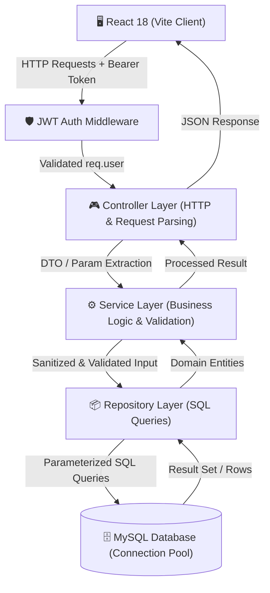

<div align="center">

# ⚡ TaskFlow

### Enterprise-Grade Full-Stack Task Management & Workflow Intelligence Platform

[](https://react.dev/)
[](https://nodejs.org/)
[](https://www.mysql.com/)
[](https://jwt.io/)
[](https://vercel.com)

<p align="center">
  <b>TaskFlow</b> is a high-performance productivity platform engineered with a strict <b>Layered Architecture (Controller-Service-Repository)</b>, dual-mode productivity views (<b>Interactive Kanban Board</b> & <b>Responsive List</b>), mathematical <b>SVG progress telemetry</b>, and a refined <b>zinc monochrome design system</b>.
</p>

[Key Features](#-key-features) • [System Architecture](#-system-architecture) • [Database Schema](#-database-schema) • [API Reference](#-api-reference) • [Design System](#-design-system) • [Quick Start](#-quick-start)

---

</div>

## 💡 Why TaskFlow?

Most task managers are built as basic CRUD tutorials with plain forms and flat tables. **TaskFlow** is engineered like real enterprise SaaS software:
- **Zero Heavy Graph Dependencies:** Progress telemetry is rendered via a custom mathematical **SVG circle algorithm** (`2πr` geometry calculations) with dynamic hardware-accelerated transitions.
- **Enterprise Design Hierarchy:** Built with a curated matte zinc dark & light theme inspired by **Linear**, **Vercel**, and **Raycast** — free from distracting neon or purple gradients.
- **Strict Layered Separation of Concerns:** Business logic, HTTP routing, and database queries are strictly isolated into distinct architectural tiers.

---

## ⚡ Key Features

<table>
  <tr>
    <td width="50%">
      <h3>▦ Interactive Kanban Board</h3>
      <ul>
        <li>Three dedicated pipeline states: <b>To Do</b>, <b>In Progress</b>, and <b>Done</b>.</li>
        <li>1-click workflow state transitions (<code>→ In Progress</code>, <code>← To Do</code>, <code>✓ Done</code>, <code>↺ Reopen</code>).</li>
        <li>Contextual task cards with due dates, priority badges, and category tags.</li>
      </ul>
    </td>
    <td width="50%">
      <h3>≡ High-Density List View</h3>
      <ul>
        <li>Custom circular checkbox toggling with instantaneous completion animations.</li>
        <li>Dynamic priority pills (<code>🔥 High</code>, <code>⚡ Medium</code>, <code>🌱 Low</code>).</li>
        <li>Category tag classification (Work, Personal, Feature, Bug, Design).</li>
      </ul>
    </td>
  </tr>
  <tr>
    <td width="50%">
      <h3>📊 Mathematical Progress Telemetry</h3>
      <ul>
        <li>Real-time dynamic SVG circular indicator calculating progress via <code>stroke-dashoffset = C - (P/100) * C</code>.</li>
        <li>Automated metric cards: <b>Open Tasks</b>, <b>Due Today</b>, <b>Completed</b>, and <b>Overdue</b>.</li>
        <li>Multi-segment proportional progress bar.</li>
      </ul>
    </td>
    <td width="50%">
      <h3>🛡️ Robust Security & Filtering</h3>
      <ul>
        <li>Stateless <b>JWT Bearer Token</b> authentication with secure password hashing via <code>bcryptjs</code>.</li>
        <li>Row-level user tenant isolation — users strictly interact with their own dataset.</li>
        <li>Live instant search, priority filtering, category filtering, and sorting.</li>
      </ul>
    </td>
  </tr>
</table>

---

## 🏛️ System Architecture

TaskFlow adopts an enterprise **Layered Controller-Service-Repository Pattern** to ensure testability, scalability, and loose coupling.



### Directory Structure

```bash
task-manager/
├── backend/
│   └── src/
│       ├── Config/          # MySQL2 connection pooling configuration
│       ├── Controller/      # Request orchestration & HTTP response formatting
│       ├── Middlewares/     # JWT authentication & route security guards
│       ├── Repository/      # Parameterized SQL query abstractions
│       ├── Routes/          # REST route declarations (/api/auth, /api/tasks)
│       ├── Services/        # Business rule validation & status constraints
│       └── app.js           # Server bootstrap & CORS/JSON middleware
├── frontend/
│   ├── src/
│   │   ├── App.jsx          # Dual-view dashboard, state management & modals
│   │   ├── App.css          # Modern Zinc design system & theme tokens
│   │   ├── main.jsx         # React application root entry point
│   │   └── index.css        # Typography & global CSS reset
│   ├── index.html           # HTML5 shell with Google Inter font
│   └── vite.config.js       # Vite build & bundler configuration
├── package.json             # Root workspace orchestration
├── README.md                # Technical documentation
└── RESUME_WRITEUP.md        # Portfolio descriptions & interview cheat sheet
```

---

## 🗄️ Database Schema & Relational Integrity

Designed in MySQL with **foreign key cascading**, **strict ENUMs**, and **automatic timestamp management**.

```sql
-- 1. Users Entity (Tenant Root)
CREATE TABLE IF NOT EXISTS users (
  id INT AUTO_INCREMENT PRIMARY KEY,
  name VARCHAR(255) NOT NULL,
  email VARCHAR(255) NOT NULL UNIQUE,
  password VARCHAR(255) NOT NULL,
  created_at TIMESTAMP DEFAULT CURRENT_TIMESTAMP
) ENGINE=InnoDB;

-- 2. Tasks Entity (User-Scoped)
CREATE TABLE IF NOT EXISTS tasks (
  id INT AUTO_INCREMENT PRIMARY KEY,
  user_id INT NOT NULL,
  title VARCHAR(255) NOT NULL,
  description TEXT,
  status ENUM('pending', 'in-progress', 'completed') DEFAULT 'pending',
  priority ENUM('low', 'medium', 'high') DEFAULT 'medium',
  category VARCHAR(50) DEFAULT 'General',
  due_date DATE,
  created_at TIMESTAMP DEFAULT CURRENT_TIMESTAMP,
  updated_at TIMESTAMP DEFAULT CURRENT_TIMESTAMP ON UPDATE CURRENT_TIMESTAMP,
  FOREIGN KEY (user_id) REFERENCES users(id) ON DELETE CASCADE,
  INDEX idx_user_status (user_id, status)
) ENGINE=InnoDB;
```

---

## 🔌 API Reference

### 🔐 Authentication Module (`/api/auth`)

| Endpoint | Method | Request Payload | Response | Description |
| :--- | :---: | :--- | :--- | :--- |
| `/api/auth/register` | `POST` | `{ name, email, password }` | `{ message, userId }` | Register a new tenant account |
| `/api/auth/login` | `POST` | `{ email, password }` | `{ token, user }` | Authenticate & issue signed JWT |

---

### 📋 Task Management Module (`/api/tasks`)
*All task endpoints require `Authorization: Bearer <JWT_TOKEN>` header.*

| Endpoint | Method | Request Payload / Params | Status Codes | Description |
| :--- | :---: | :--- | :---: | :--- |
| `/api/tasks` | `GET` | *None* | `200` | Fetch all tasks belonging to current user |
| `/api/tasks` | `POST` | `{ title, description, status, priority, category, dueDate }` | `201`, `400` | Create a new task with validation |
| `/api/tasks/:id` | `GET` | Route param `:id` | `200`, `404` | Fetch a single task by ID |
| `/api/tasks/:id` | `PUT` | Partial or full task updates | `200`, `400`, `404` | Update task details or move status |
| `/api/tasks/:id` | `DELETE`| Route param `:id` | `200`, `404` | Delete task with confirmation |

---

## 🎨 Design System & Palette

TaskFlow implements a custom **monochrome palette** crafted for developer tools:

```
Dark Theme  : Deep Obsidian (#09090b) ── Slate Card (#121316) ── Zinc Border (#27272a)
Light Theme : Crisp Snow   (#ffffff) ── Slate Shell (#f8fafc) ── Platinum Border (#e2e8f0)
Accents     : Emerald (#10b981 - Complete) ── Crimson (#ef4444 - High) ── Sky (#38bdf8 - Medium)
```

- **Typography:** Modern variable font `Inter` via Google Fonts.
- **Glassmorphism & Modals:** Backdrop blur (`backdrop-filter: blur(6px)`) with keyboard-accessible modals for task editing and confirmation.
- **Micro-Animations:** Fluid CSS transitions on card hover, badge pills, and tab switching.

---

## 🚀 Quick Start Guide

### 1. Prerequisites
- **Node.js** v18+ & **npm**
- **MySQL Server** (running on `localhost:3306`)

### 2. Database Initialization
Open MySQL Workbench or your terminal:
```sql
CREATE DATABASE IF NOT EXISTS task_manager;
```

### 3. Environment Variables
Create a `.env` file in the root directory:
```env
PORT=3000
DB_HOST=localhost
DB_USER=root
DB_PASSWORD=your_mysql_password
DB_NAME=task_manager
JWT_SECRET=your_super_secure_jwt_secret_token
```

### 4. Installation & Launch

```bash
# 1. Install root & backend dependencies
npm install

# 2. Start the backend server (Port 3000)
npm run dev
```

In a second terminal:
```bash
# 3. Enter frontend directory
cd frontend

# 4. Install frontend dependencies
npm install

# 5. Start Vite development server (Port 5173)
npm run dev
```

Visit **`http://localhost:5173`** in your browser.

---

## 🧪 Production Verification

To verify production builds:
```bash
cd frontend
npm run build
```
✓ Built in ~1.2s with zero warnings.

---

## 👨‍💻 Author & Contributions
Engineered as a modern showcase of full-stack engineering, clean code architecture, and high-performance UI engineering.
Contributions, issues, and feature requests are welcome!
# Task-Flow
